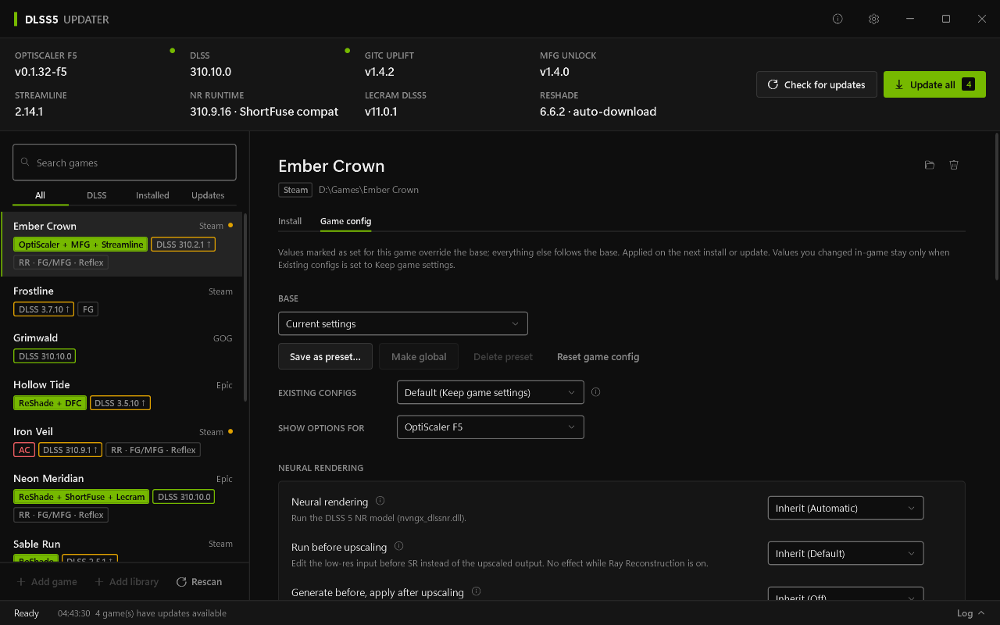
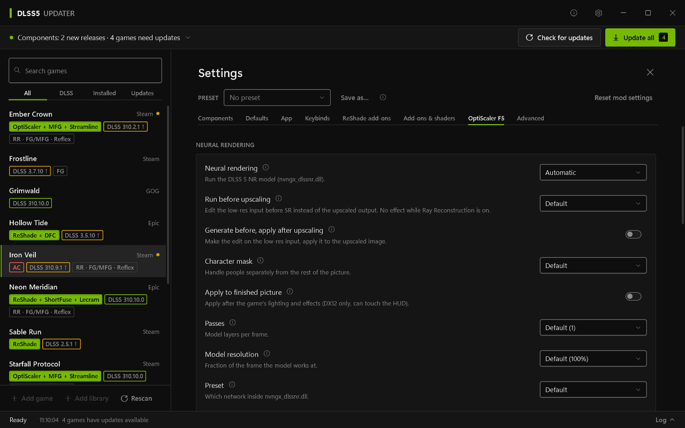
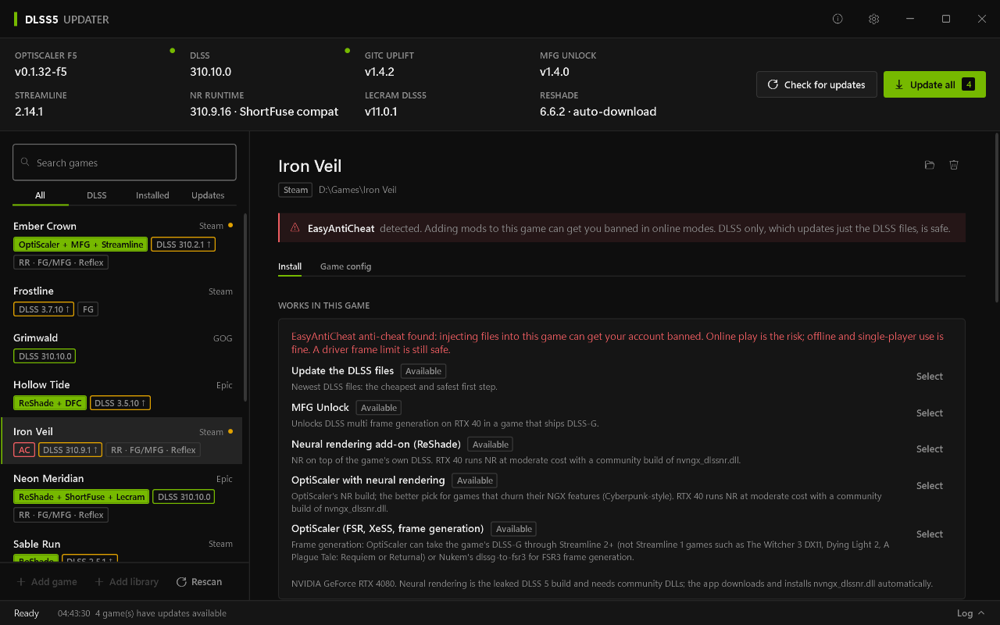

# DLSS5 Updater

DLSS5 Updater is a free Windows app that finds the PC games on your computer and installs or updates graphics mods in them: OptiScaler, NVIDIA DLSS, NVIDIA Streamline, MFG Unlock, ReShade with its add-ons and shaders, RenoDX and Luma HDR mods, DXVK and frame limiters. It downloads the files from their official sources or its own mirror of them, checks each download against its checksum, puts them in the right game folder and keeps a backup of everything it replaces. One click puts your original files back.

It is for people with an NVIDIA RTX card who play single-player games and want newer DLSS versions or the extra graphics options these mods offer, without copying DLL files around by hand.

It is an unofficial tool, not affiliated with or endorsed by NVIDIA or the mod authors (see [Credits](#credits)).

Formerly called DLSS Updater. Updating keeps your settings: the app moves `%LocalAppData%\DLSSUpdater` to `%LocalAppData%\DLSS5Updater` on first start.

## Screenshots


The game list and one game's components. Badges show what each game has installed, and an arrow marks an outdated DLSS version.



Settings for one game. Anything you don't change here follows your global settings.



Settings for all games. Every option has a short explanation, and the help button next to it tells you more.

## Features

- Finds games from Steam, Epic, GOG, EA, Ubisoft, Battle.net, Rockstar and Xbox. You can also add a single game folder or a whole library folder.
- Checks for new releases of every component and shows installed and latest versions side by side.
- Installs or updates the mods for one game, or for all managed games with **Update all**.
- Swaps only the DLSS files with **DLSS only**, without adding any other mod. You can pin an older DLSS version if a newer one looks worse in a game.
- Backs up every game file it replaces. **Restore DLSS** and **Uninstall** bring them back.
- Detects each game's graphics API, 32 or 64-bit, engine and Unreal version, and the **Works in this game** panel lists which mods fit that game and why. Anything it detects or picks on its own can be changed per game.
- Installs HDR mods: the RenoDX or Luma mod made for the game, or the generic Unreal or Unity one.
- Installs DXVK (Stable, Development or the Lilium HDR fork) in DX8 to DX11 games.
- Limits the frame rate per game with the NVIDIA driver cap, ReLimiter, Display Commander or Unreal's own cap.
- Installs ReShade add-ons, shader packs and presets per game, from the catalog or your own files.
- Warns before installing things that don't go well together, or into a game that ships anti-cheat software. You see why and decide.
- Lets you change the mods' settings in the app, as defaults for all games or for single games. Presets save a whole setup under a name. Every option has a short explanation, and the About page has a guide.
- Can set per-game NVIDIA driver profile options such as DLSS presets, MFG, Smooth Motion, RTX HDR and the FPS limiter, and puts back the previous values when you reset or uninstall. It never writes the global driver profile.
- Shows a short summary of what is new when a component gets a new release.

## What it supports

| Component | What it is | Where it comes from |
|---|---|---|
| [OptiScaler F5](https://github.com/janblade/OptiScaler-F5-DLSSNR-Multipass) | janblade's fork of OptiScaler with DLSS neural rendering (NR). The default build for new installs. | Downloaded from GitHub. |
| [OptiScaler-NR](https://github.com/ShyVortex/OptiScaler-DLSSNR-PreSR-Multipass) | ShyVortex's fork of OptiScaler with DLSS neural rendering. Can be chosen in Settings instead of F5. | Downloaded from GitHub. |
| [OptiScaler](https://github.com/optiscaler/OptiScaler) | Lets a game use DLSS, FSR or XeSS as its upscaler. | Parent project of the forks above. |
| [NVIDIA DLSS](https://github.com/NVIDIA/DLSS) | The DLSS runtime files for upscaling, ray reconstruction and frame generation. | Downloaded from NVIDIA's GitHub. |
| [NVIDIA Streamline](https://github.com/NVIDIA-RTX/Streamline) | The layer between a game and DLSS frame generation. Optional. | Downloaded from NVIDIA's GitHub. |
| [MFG Unlock](https://github.com/mavismmg/MFGAdaUnlock-RenoDx) | A ReShade add-on that unlocks multi frame generation: DLSS-G on RTX 40 cards, Intel XeMFG on RTX 20/30. | Downloaded from GitHub. |
| [ReShade](https://reshade.me) | Post-processing and add-on loader. | Downloaded from reshade.me (add-on build, build without add-ons, older versions) or from crosire's CI (nightly), or imported. Every build is kept in a library; the file name follows the game's graphics API and Vulkan games use the Vulkan layer. |
| [GITC Uplift](https://github.com/ghostinthecamera/GITC-Uplift) | A ReShade add-on that runs DLSS neural rendering. Replaces the other neural rendering routes. | Downloaded from GitHub. |
| NVIDIA DLSS neural rendering runtime | `nvngx_dlssnr.dll`, the file the neural rendering routes run on. | Downloaded and installed automatically. You can also import your own. |
| [RenoDX DLSS add-on](https://github.com/clshortfuse/renodx) | ShortFuse's ReShade add-on for neural rendering. | Downloaded and installed automatically, or imported. |
| Lecram DLSS5 add-on | A ReShade add-on for neural rendering by Lecram. | You import it yourself; get new builds from the author's page. |
| Deep Fried Chicken | A neural rendering add-on. Its licence allows personal use only. | You import the extracted release folder (or a .zip) yourself. Every import is kept, and each game can use its own version. |
| DLSS5-Feeder | An MIT ReShade add-on that makes the DLSS calls for games without DLSS, so Deep Fried Chicken can run in them. DLAA only. | Downloaded from its GitHub releases and checked against the SHA-256 GitHub publishes. Single-player games only. |
| [RenoDX HDR mods](https://github.com/clshortfuse/renodx) | ShortFuse's and the community's per-game HDR mods, plus generic Unreal and Unity ones. ReShade add-ons. | From the catalog. |
| [Luma](https://github.com/Filoppi/Luma-Framework) | Per-game HDR and graphics mods by Pumbo and others, plus a generic Unreal one. ReShade add-ons. | From the catalog, downloaded from Luma's GitHub releases. |
| [DXVK](https://github.com/doitsujin/dxvk) | Runs DX8 to DX11 games through Vulkan. The [Lilium fork](https://github.com/EndlesslyFlowering/dxvk) adds HDR. | Downloaded from GitHub (Stable, Development builds and Lilium). |
| ReLimiter and [Display Commander](https://github.com/pmnoxx/display-commander) | Frame limiters as ReShade add-ons. | From the catalog, or imported. |
| ReShade add-ons and shader packs | Other add-ons, shader collections and presets for ReShade. | From the catalog, or imported. |

"From the catalog" means the app reads the list of mods and builds in [ApolloF/DLSS5-Updater-catalog](https://github.com/ApolloF/DLSS5-Updater-catalog), which updates every 6 hours, and downloads each file from there or from its author. Every file is checked against the SHA-256 in the catalog before it is used.

The app only replaces files in a game with files from the sources above or files you imported. Which of these you use is up to you. Most people only need the OptiScaler mode or **DLSS only**.

## Requirements

- Windows 10 or Windows 11, 64-bit.
- An NVIDIA RTX graphics card for DLSS. Some features need a newer card (frame generation needs RTX 40 or 50, for example). Each option's explanation in the app says so.
- An internet connection to download components. The app keeps what it has downloaded and works offline with that.
- A game in a folder you can write to. If a game sits in a protected folder, the app asks to restart with administrator rights.

You do not need to install .NET. The app brings what it needs.

## Download and install

Get the latest version from the [releases page](https://github.com/ApolloF/DLSS5-Updater/releases/latest). Each release has two programs, plus `SHA256SUMS` with their checksums:

- `DLSS5Updater-Setup-<version>.exe` is the installer. It installs for your user without administrator rights (or for all users if you choose), adds a Start menu entry, can add a desktop icon and has an uninstaller. To update the app, run a newer setup.
- `DLSS5Updater.exe` is the portable version. It is a single file. Put it anywhere and run it.

The app checks GitHub for a newer version of itself (at most every 6 hours, or with **Check now** in Settings) and shows **Update to vX.Y.Z** in the title bar. Updating downloads the setup or the portable exe, whichever you use, checks it against the release's `SHA256SUMS` and restarts the app. **Install updates automatically** (off by default) downloads in the background and installs when you close the app. It never updates while a task is running.

Both versions keep settings and downloads in `%LocalAppData%\DLSS5Updater`, so you can switch between them without losing anything.

## First run

On a fresh install a short setup opens over the window: a welcome, the default install mode (OptiScaler F5 or OptiScaler-NR, or ReShade + add-ons with one NR add-on), and update and download choices. **Skip** or Esc on any step keeps the defaults; Enter goes to the next step. Nothing is written until you finish. People upgrading from 1.x don't see it, but **Settings → App → Run setup again** opens it any time.

1. Start the app. It scans your game libraries and lists the games it finds. To add a game it missed, use **Add game** (one game folder) or **Add library** (a folder whose subfolders are games) at the bottom of the list.
2. The files neural rendering needs (`nvngx_dlssnr.dll` and the NR add-ons) are downloaded and installed automatically when an install needs them. To use your own copy instead, import it under **Settings → Components**. The app keeps them in `%LocalAppData%\DLSS5Updater\components`, several versions side by side, and you can pick a default.
3. ReShade is downloaded the first time an install needs it. Pick another build, channel or your own import under **Settings → ReShade add-ons**; each game can pick its own.

## Everyday use

1. Pick a game in the list. The filters at the top (**All**, **DLSS**, **Installed**, **Updates**) help you find games.
2. Choose how to install:
   - **OptiScaler** is the default (the F5 build unless you pick OptiScaler-NR under **OptiScaler build** in Settings). It installs OptiScaler as a proxy DLL (`dxgi.dll` unless you change it), plus ReShade, MFG Unlock and the DLSS files.
   - **ReShade + add-ons** installs ReShade itself as the proxy, with MFG Unlock and the DLSS and Streamline updates, and without OptiScaler.
   - You can set the default mode in Settings and change it for a single game.
3. Press **Install**. The button reads **Update** when a newer release is available and **Reinstall** when the game is current.
4. Press **DLSS only** if you just want the game's DLSS files replaced and nothing else added.
5. After a new release or a game patch, press **Update all** at the top to re-apply everything to every managed game.
6. Change settings in the game's own tabs (**Install**, **Game config**, **NVIDIA profile**, **Add-ons & shaders**), or in **Settings** for all games. Hover the info icons or open the guide on the About page when you are unsure what an option does.
7. In the game, the OptiScaler menu opens with the **Insert** key by default, and the ReShade overlay with **Home**. Both can be changed in the Keybinds tab.

Existing config files are handled in the way you choose under **Existing game configs**: keep the game's values (the default), apply your app settings over them, or start from a fresh config.

## Safety, backups and restore

- Before the app replaces or removes a game file, it saves the original in a `.dlssupdater\backup` folder next to the game's exe. A record in that folder lists every file the app added or changed.
- **Restore DLSS** puts the original DLSS and Streamline files back.
- **Uninstall** removes everything the app installed in that game and restores the original files.
- The app only changes files inside the game's own folder, with two exceptions: an Unreal game's `Engine.ini` (for HDR mods and the frame cap, put back on remove) and the ReShade Vulkan layer in `C:\ProgramData\ReShade`, which you install from Settings. It checks its own records before restoring so a damaged record cannot make it touch files elsewhere.
- Games that ship anti-cheat software are marked with an **AC** badge. Before installing a mod into one, the app shows a warning and asks you to confirm.



**Do not use these mods in online games with anti-cheat.** Replacing or injecting DLL files can get your account banned, and many online modes refuse to start. The app recognises common anti-cheat systems (Easy Anti-Cheat, BattlEye, EA Javelin, GameGuard, XIGNCODE3, PunkBuster, Vanguard and others), but no check is complete. If you are unsure, do not install. **DLSS only** swaps the DLSS files without injecting anything and does not ask for this confirmation, but changing game files is never risk-free. For online games, use the DLSS override in the NVIDIA app instead.

## Troubleshooting

**A game is missing from the list.**
Press **Rescan**. If it is still missing, add its folder with **Add game**, or its library folder with **Add library**.

**The app says Windows blocked access to a game folder.**
Close the game and anything that may be using its files, such as overlays or a running antivirus scan, then try again. If the game is in a protected folder, choose **Restart as admin** when asked.

**A game crashes or looks wrong after installing.**
Press **Uninstall** for that game to restore the original files. Then try the **ReShade + add-ons** mode, a different proxy DLL name (Settings, General) or a different DLSS version.

**There are no OptiScaler updates.**
The OptiScaler-NR fork publishes pre-releases only. Keep **Include pre-releases** turned on in Settings.

**The app cannot reach GitHub.**
It uses what it already downloaded and shows an **OFFLINE** label. Try again later with **Check for updates**. If GitHub limits how often the app may ask, a banner says until when. Adding a free GitHub token in **Settings → App** lifts that limit.

**Where are the logs?**
Open the log panel in the app. Data, cache and the log file are in `%LocalAppData%\DLSS5Updater`.

## Uninstall

Use **Uninstall** on each game first if you want the original game files back. Then remove the app through Windows Settings, Apps (installer version) or delete `DLSS5Updater.exe` (portable version). The uninstaller keeps `%LocalAppData%\DLSS5Updater`. Delete that folder yourself if you want the settings and downloads gone as well.

## Build from source

You need the .NET 8 SDK on Windows.

```
dotnet build -warnaserror
dotnet test
dotnet publish src/DLSSUpdater -c Release -o publish
```

The last command makes the portable `publish\DLSS5Updater.exe`. The installer needs [Inno Setup 6](https://jrsoftware.org/isinfo.php):

```
iscc /DAppVersion=3.1.1 installer\DLSSUpdater.iss
```

Pushing a tag like `v2.0.0` that matches the version in the project file builds both files on GitHub Actions and attaches them to a release. If `docs/releases/v<version>.md` exists, it becomes the release text. Setting `DLSSU_INTEGRATION=1` turns on a test that downloads the real releases and installs them into a temporary folder.

`DLSS5Updater.exe --demo` starts the app on a made-up game library in a temporary folder. It never scans your launchers, downloads anything or touches your games, so it is a safe way to look around. `--demo --screenshots <folder>` saves the screenshots used in this README to that folder and exits. Setting `DLSSU_DEMO_ONBOARDING=1` opens the first-run setup in the demo, which it otherwise leaves out.

## Credits

DLSS5 Updater installs the work of these projects and their authors. It downloads their files as released and does not change them.

- [OptiScaler](https://github.com/optiscaler/OptiScaler), the [OptiScaler F5 fork](https://github.com/janblade/OptiScaler-F5-DLSSNR-Multipass) by janblade and the [OptiScaler-NR fork](https://github.com/ShyVortex/OptiScaler-DLSSNR-PreSR-Multipass) by ShyVortex.
- [MFG Unlock](https://github.com/mavismmg/MFGAdaUnlock-RenoDx) by mavismmg.
- [ReShade](https://reshade.me) by crosire.
- [RenoDX](https://github.com/clshortfuse/renodx) and [openNR](https://github.com/clshortfuse/openNR) by ShortFuse.
- [GITC Uplift](https://github.com/ghostinthecamera/GITC-Uplift) by ghostinthecamera.
- The DLSS5 add-on by Lecram and Deep Fried Chicken by its author.
- [Luma Framework](https://github.com/Filoppi/Luma-Framework) by Pumbo and its mod authors.
- [DXVK](https://github.com/doitsujin/dxvk) by doitsujin and its [Lilium HDR fork](https://github.com/EndlesslyFlowering/dxvk) by EndlesslyFlowering.
- ReLimiter by RankFTW and [Display Commander](https://github.com/pmnoxx/display-commander) by pmnoxx.
- [DLSS5-Feeder](https://github.com/jlrouzies-fr/DLSS5-Feeder) by jlrouzies-fr.
- The authors of the RenoDX HDR mods, ReShade add-ons and shader packs listed in the catalog.
- [NVIDIA DLSS](https://github.com/NVIDIA/DLSS) and [NVIDIA Streamline](https://github.com/NVIDIA-RTX/Streamline) by NVIDIA.

DLSS5 Updater is released under the [MIT License](LICENSE). The files it downloads and installs keep their own licences.

DLSS5 Updater is an unofficial tool. It is not affiliated with or endorsed by NVIDIA or by the authors of the projects above. NVIDIA, DLSS and Streamline belong to NVIDIA Corporation. OptiScaler, ReShade and the other projects belong to their authors. Their names are used here only to say what the app works with.

## Support

DLSS5 Updater is free. If it is useful to you, you can leave a tip on [Ko-fi](https://ko-fi.com/apollof). Bug reports and ideas are welcome on the [issues page](https://github.com/ApolloF/DLSS5-Updater/issues).
